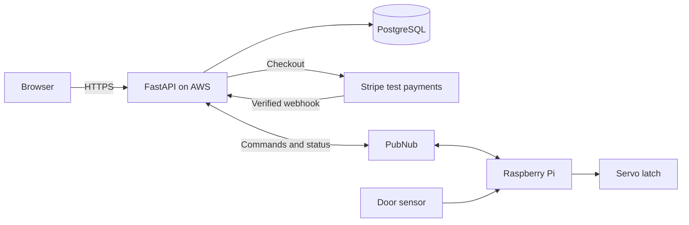

# PayBox

PayBox is an IoT smart locker project for short-term storage. The idea is to let a user
rent a locker through a web app, pay using Stripe test payments and open it from their account.
A Raspberry Pi controls the latch and reports the door status.

## How it will work

1. Sign in and check locker availability, price and rental end time.
2. Reserve the locker and complete a test payment.
3. Open the locker and reopen it during the rental without paying again.
4. Collect belongings, confirm the locker is empty and close the door to finish.

The first version uses Locker 4 at EUR 1 per calendar day, with 1 day selected by default
and up to 4 days payable in advance. Days end at 18:00 in Ireland; starts at or after 18:00
count the next date as day one. EUR 1 becomes due at the unpaid deadline and each following
18:00 until collection and rental completion. Payments will be in test mode, with no real money
charged. The web pages should work on mobile and be easy to use
with clear labels, keyboard controls and readable status messages.

## Planned stack

| Part             | Technology                                             |
|------------------|--------------------------------------------------------|
| Web app          | Python, FastAPI, Jinja2, HTML, CSS and JavaScript      |
| Database         | PostgreSQL                                             |
| Device messaging | PubNub, subject to channel access control availability |
| Payments         | Stripe test environment                                |
| Hardware         | Raspberry Pi, servo latch and door contact sensor      |
| Hosting          | AWS, Nginx and Uvicorn, with a custom HTTPS domain     |

The hardware prototype will use a small box, breadboard, jumper wires and suitable power supplies.

## Architecture

PostgreSQL will store users, lockers, rentals, payments and device commands/events.
The server will check payments and rental ownership before sending an unlock command.

## Main rules

- Require login and check ownership before showing rental data or allowing access.
- Prevent two users from reserving the same locker. Verify payment webhooks and handle repeated events only once.
- Give commands unique IDs and expiry times so stale or repeated messages cannot reopen the locker.
- Show payment, command acknowledgement and actual door state separately. Flag offline devices and failed access for
  assistance.
- Do not release a locker just because the rental expires. Require confirmed collection and a closed door; unknown
  sensor state needs assistance.
- Keep secrets out of Git, hash passwords, protect sessions and forms, and restrict device channels and server/database
  access.
- Use encrypted connections and encrypted storage/backups. Card details stay with Stripe.

## Registration API

`POST /api/register` accepts JSON with `email` and `password` (15–128 characters).
It returns the user's `id` and normalised `email`: 201 on success, 409 for an existing
email, or 422 for invalid input. Passwords are stored as Argon2 hashes.
Open `/register` or select **Create account** on the locker list to register.
Use `/login` to sign in. A session lasts 24 hours; **Sign out** revokes it.
Sessions use an HttpOnly cookie, with Secure enabled on HTTPS. Session keys are
stored as hashes in the database. Rental pages require sign-in; guests return to
their selected locker after signing in.

**Reserve locker** saves a `pending` rental for up to 15 minutes (or until the
rental deadline, if sooner). The server checks consent and calculates the price
and 18:00 Ireland end time. Repeating the same reservation returns the existing
record. Expired pending holds no longer block availability and are marked
`cancelled` when a new reservation is made. Active and overdue rentals still block
the locker. Payment and physical access are not implemented yet; payment status
must be reconciled before releasing holds once Stripe is added.

`POST /api/login` accepts email and password; `GET /api/me` returns the signed-in
user. `POST /api/logout` signs out. Login and logout requests require the header
`X-PayBox-Request: 1`; the web forms send it automatically.

Run the isolated registration tests from `backend/`:
`uv run python -m unittest discover -s tests -v`.

## Project files

- `backend/` - FastAPI server, database connection and SQL files.
- `frontend/` - HTML templates, CSS and JavaScript, served by FastAPI.
- `android/` - Android prototype.
- `docs/` - Implementation plan, presentation and design images.
- [Implementation plan](docs/implementation-plan.md) - Next development steps.
- [Database plan](docs/database.md) - Proposed tables, fields and relationships.
- [AI assistance log](AI_Chat_Log.md) - Brief record of AI help.
