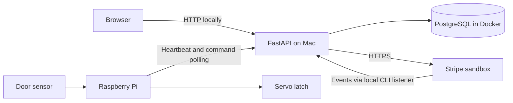

# PayBox

PayBox is a mobile-friendly campus locker prototype. Users register, reserve a locker,
pay through Stripe in test mode and open it from their account. A Raspberry Pi 400
controls the servo latch and reports the magnetic door sensor.

## How it works

1. Sign in and choose Locker 4, the only physical locker. The other eight are placeholders.
2. Select 1–4 calendar days, accept the terms and reserve. The default is one day at EUR 1.
3. Continue to the rental page and select **Pay**. Confirmed payment enables access.
4. Use **Open locker** during the paid period. Your locker card shows **Continue rental**.
5. Select **Finish rental**, collect everything and close the door. The controller
   verifies closure and acknowledges completion before the locker becomes available.

Days end at **18:00, Europe/Dublin**. Before 18:00, the reservation date is day one;
at or after 18:00, the next date is day one. The deadline is calculated when reserving
and does not move when payment is confirmed. Prices and times are checked by the server.

An unpaid reservation is held for up to 15 minutes. Starting checkout keeps it blocked
until Stripe payment is reconciled; checkout has its own expiry. Rental status, door state
and availability update automatically while the page is visible. A closed door reading
does not prove that the latch is locked.

## Current stack

| Part | Technology |
|------|------------|
| Web app | Python, FastAPI, Jinja2, HTML, CSS and JavaScript |
| Database | PostgreSQL 16 in Docker |
| Payments | Stripe sandbox Checkout and verified webhooks |
| Hardware | Raspberry Pi 400, SG92R servo and magnetic contact sensor |
| Device connection | HTTP heartbeat and command polling on the local network |



AWS hosting, HTTPS deployment and PubNub are not part of the current implementation.
Passwords use Argon2; session tokens are stored as hashes. Sessions last 24 hours and
use an HttpOnly cookie, with Secure enabled on HTTPS. Rental access requires ownership
and confirmed payment. Device requests require a separate key; commands expire and
are dispatched only once. Card details stay with Stripe.

## Run locally

Prerequisites: Docker Desktop, Python 3.11 or later, and `uv`.
For first-time setup, copy `.env.example` to `.env` and fill in the required values.
Keep `.env` out of Git; do not overwrite an existing configuration.

From the project folder, with Docker Desktop running:

```sh
docker compose up -d db
```

On a new database, Docker creates the tables. Then add the nine locker records using
[the migration instructions](docs/database.md#initial-setup). Existing data is retained.

From `backend/`:

```sh
uv sync
uv run uvicorn main:app --host 0.0.0.0 --port 8000
```

Open `http://127.0.0.1:8000` on the Mac. In PyCharm, use a Python run configuration:
module `uvicorn`, parameters `main:app --host 0.0.0.0 --port 8000`, working directory
`backend`, and the `backend/.venv` interpreter. Stop any existing server before starting another.

The database and backend must stay running. See [Raspberry Pi setup](hardware/README.md)
for the controller's automatic startup and local network configuration.

## Stripe testing

Set `STRIPE_SECRET_KEY` to a sandbox key beginning with `sk_test_` in `.env`.
Set `APP_BASE_URL` to the browser address used for checkout; the default is
`http://127.0.0.1:8000`. Install Stripe CLI, then run from `backend/`:

```sh
uv run python listen_stripe.py
```

The listener saves `STRIPE_WEBHOOK_SECRET` in `.env`. Restart the backend when it reports
ready and keep the listener running. The pending rental page also checks payment with
Stripe periodically, roughly every 10 seconds, to recover missed events.
Use test card `4242 4242 4242 4242`, a future expiry and any three-digit CVC. No real money is charged.

## Tests

From `backend/`:

```sh
uv run python -m unittest discover -s tests -v
```

To include database tests, start PostgreSQL and prefix the command with
`PAYBOX_TEST_POSTGRES=1`. These tests use isolated database schemas.

## Project files and remaining work

- `backend/main.py` — Application setup; `routes/` — Page, API and device routes.
- `backend/auth/` — Accounts and sessions; `services/` — Rental, payment and command logic.
- `backend/database.py` — Connection; `backend/database/` — SQL schema and migrations.
- `frontend/` — Templates, CSS and JavaScript served by FastAPI.
- `hardware/` — Pi scripts, configuration example and systemd services.
- `android/` — Earlier Android prototype.
- [Database](docs/database.md), [implementation plan](docs/implementation-plan.md) and [AI assistance log](AI_Chat_Log.md).

Automatic EUR 1 daily overdue charging, payment-method setup and scheduled overdue status
updates are not implemented. Overdue access currently needs operator assistance; contact
details still need to be supplied. See the plan for deployment and submission tasks.

The Checkpoint 1 presentation in `docs/` records the original proposal, including Flask,
PubNub and AWS. It is historical; this README describes the current implementation.
