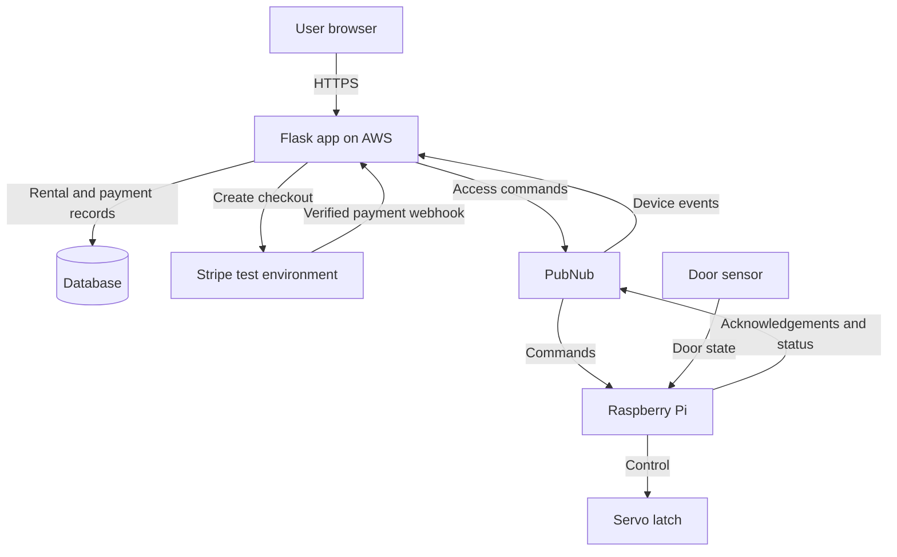

# PayBox

**An IoT smart locker prototype for short-term storage rental, with Stripe test payments and remote access control.**

## Overview

PayBox lets a user rent a small storage locker for a short period, pay through a web application, and open their
assigned locker from their account. A Raspberry Pi controls a physical latch and reports device status to the
application through PubNub.

The initial use case is a student who needs somewhere to leave personal belongings for the day without committing to a
long-term locker rental.

## Problem and intended users

Someone visiting a campus for a few hours may need temporary storage for a bag or personal items. A long-term rental may
not suit that occasional need. A short-term system should make availability, pricing, payment, and access easy to
understand.

PayBox aims to let users:

- Check whether a locker is available before paying.
- See the price and rental end time clearly.
- Pay once for the rental.
- Reopen their locker during the rental without paying again.
- See their rental and payment history.
- Understand what to do if payment or access fails.

## Initial rental model

The proposed first version uses **one locker and one fixed daily price**, for example **EUR 1 for storage until the
displayed end-of-day closing time**. This is an illustrative demonstration price, not a validated commercial tariff.

The application must display the exact end time before checkout. Rental timestamps will be stored in UTC and displayed
in the site's local timezone. A day pass is not a rolling 24-hour rental.

Payment buys the rental, not an individual door opening. The renter can request access repeatedly while their rental is
active. There are no automatic late fees, subscriptions, or per-minute charges in the initial scope.

## User journey

1. **Sign in:** the user opens the Flask web application and signs into their account.
2. **Choose the locker:** the page shows availability, device connectivity, price, and the exact rental end time.
3. **Reserve for checkout:** the backend temporarily reserves the locker so another user cannot rent it simultaneously.
4. **Pay:** the user completes Stripe checkout using the test environment. No real money is charged in the prototype.
5. **Confirm payment:** the backend verifies the payment notification and associates it with the correct rental. A
   browser success page alone must not grant access.
6. **Activate access:** the rental becomes active and the backend requests an initial unlock through PubNub.
7. **Store belongings:** the Raspberry Pi moves the latch. The user opens the door, puts belongings inside, and closes
   it. The device reports door state if a sensor is fitted.
8. **Reopen when needed:** the user selects “Open my locker.” The backend checks rental ownership and permission before
   issuing another command.
9. **Finish the rental:** the user retrieves their belongings, confirms that the locker is empty, and closes the door.
   The backend completes the rental and releases the locker only after the required checks.

## Physical classroom prototype

| Component                     | Purpose                                                             |
|-------------------------------|---------------------------------------------------------------------|
| Raspberry Pi                  | Runs the device-side Python program and communicates through PubNub |
| Small cardboard or wooden box | Represents one storage compartment                                  |
| Small servo and simple latch  | Demonstrates physical locking and unlocking                         |
| Door contact sensor           | Reports open/closed state; planned for the complete prototype       |
| LED with suitable resistor    | Optional additional visual status indicator                         |
| Breadboard and jumper wires   | Connects the low-voltage circuit                                    |
| Suitable power supplies       | Powers the Pi and servo according to their electrical requirements  |

## Planned technology stack

| Layer            | Proposed technology                    | Responsibility                                                    |
|------------------|----------------------------------------|-------------------------------------------------------------------|
| Frontend         | Flask templates, HTML, CSS, JavaScript | Accessible rental and account pages                               |
| Backend          | Python and Flask                       | Authentication, rental rules, payment processing, device commands |
| Database         | PostgreSQL                             | Users, lockers, rentals, payment records, device events           |
| Payments         | Stripe test environment                | Simulated checkout and payment notifications                      |
| Device messaging | PubNub                                 | Backend-to-device commands and device-to-backend status           |
| IoT controller   | Raspberry Pi and Python                | Latch control, sensor readings, command acknowledgements          |
| Hosting          | AWS with a custom domain               | Cloud-hosted application                                          |
| Web serving      | Nginx and a production WSGI server     | HTTPS entry point and Flask hosting                               |
| Version control  | Git and GitHub                         | Source code, documentation, and development history               |

## Proposed architecture

The backend is responsible for payment and access decisions. The browser does not publish unlock commands directly. The
Pi receives only the information necessary to operate its assigned locker, not payment credentials or card details.

A successful payment and a successful physical unlock are separate events. The UI must distinguish “Payment confirmed,”
“Unlock requested,” and “Device acknowledged,” and must not claim that a door opened without evidence. A servo command
alone does not prove that the latch moved successfully.

## Core features and scope

### Minimum viable product

- Account registration, sign-in, and sign-out.
- One locker with a fixed rental price and explicit expiry time.
- Availability and device connectivity display.
- Temporary checkout reservation to prevent double booking.
- Stripe test checkout and verified payment notifications.
- Physical unlock requests through PubNub.
- Rental ownership checks for every access request.
- Door state reporting and command acknowledgement.
- Active rental page and payment history.
- Rental completion and overdue handling.
- Basic operator view for faults and unresolved rentals.
- Deployment on AWS under a custom domain using HTTPS.

### Outside the first version

- Real-money operation or commercial deployment.
- Multiple locations or a large fleet of lockers.
- Hourly billing, subscriptions, deposits, and automatic late fees.
- Native mobile applications.
- RFID access, face recognition, or biometric identification.
- Automatic detection that the locker is empty.
- A certified or tamper-resistant locking mechanism.

## Rental, payment, and device states

| Area                | Proposed states                                                              |
|---------------------|------------------------------------------------------------------------------|
| Rental              | Awaiting payment, active, overdue, completed, cancelled, requires assistance |
| Payment             | Pending, succeeded, failed, refunded                                         |
| Locker allocation   | Available, reserved, occupied, unavailable                                   |
| Device connectivity | Online, offline, unknown                                                     |
| Door observation    | Open, closed, unknown                                                        |
| Unlock command      | Pending, acknowledged, failed, expired                                       |

## Important edge cases

| Situation                                             | Intended behaviour                                                                                                      |
|-------------------------------------------------------|-------------------------------------------------------------------------------------------------------------------------|
| Two users try to rent the same locker                 | Enforce one reservation or live rental using transactional database checks                                              |
| Checkout is cancelled or abandoned                    | Expire the reservation and release it only when payment state has been reconciled                                       |
| Payment confirmation arrives after reservation expiry | Do not grant access to a locker assigned elsewhere; flag the paid order for resolution and a test refund if appropriate |
| A payment notification is delivered twice             | Record its event identifier and process the business action only once                                                   |
| A device command is delivered twice                   | Use a unique command ID so the Pi does not repeat an already processed action                                           |
| Payment succeeds but the device is offline            | Preserve the successful payment, show the access failure, and mark the rental for assistance; do not charge again       |
| The device reconnects later                           | Reject expired commands instead of executing stale unlock requests                                                      |
| Another account requests access                       | Reject the request after checking the rental owner on the backend                                                       |
| The rental expires with belongings inside             | Mark it overdue, keep it allocated, and provide an authenticated retrieval or operator-assisted path                    |
| The user ends a rental with the door open             | Keep the locker unavailable until completion conditions are satisfied                                                   |
| The door sensor is unavailable                        | Display unknown status and require operator resolution rather than automatically releasing the locker                   |

Expiry must never automatically open the locker or make it available to another user.

## Proposed data model

| Entity        | Example information                                                                                 |
|---------------|-----------------------------------------------------------------------------------------------------|
| User          | ID, email, password hash, role                                                                      |
| Locker        | ID, display name, device identifier, allocation state, last seen time, door state                   |
| Rental        | ID, user ID, locker ID, reservation expiry, start time, end time, status, agreed price and currency |
| Payment       | ID, rental ID, provider reference, amount, currency, payment status                                 |
| PaymentEvent  | Provider event ID, processing state, received time                                                  |
| DeviceCommand | Unique command ID, locker ID, rental ID, action, expiry, acknowledgement status                     |
| DeviceEvent   | Locker ID, event type, event time, relevant status details                                          |

## Security plan

- Use HTTPS for browser access and encrypted connections between services.
- Hash passwords using an established password-hashing library.
- Protect sessions with appropriate cookie settings and protect state-changing browser requests against CSRF.
- Verify payment webhook signatures and validate the associated rental, amount, currency, and successful payment state.
- Store secret keys in server-side configuration, never in Git or browser code.
- Restrict PubNub publishing and subscribing to the required device-specific channels using appropriate access controls.
- Give the Pi a limited device identity rather than application administrator credentials.
- Authorise every unlock request on the server; knowing a locker ID is not permission to open it.
- Use short-lived commands with unique IDs to limit stale or repeated actions.
- Restrict database network access and use least-privilege credentials.
- Configure encryption at rest for cloud database storage and backups; minimise data held on the Pi and protect device
  configuration.
- Restrict administrative and SSH access, maintain the device, and record important access events without logging
  secrets.
- Keep card entry within the payment provider's checkout flow; do not store card details in PayBox.

## Usability and accessibility

- Clear prices and rental end times before payment.
- Large, clearly labelled controls and a short, predictable flow.
- Keyboard navigation, visible focus states, and meaningful form labels.
- Screen-reader-friendly status messages.
- Text and icons alongside colour for availability and errors.
- Responsive pages that work in a browser without installing an app.
- Plain-language messages explaining what happened and what the user can do next.
- No QR-code-only access: provide a normal web address and locker identifier as alternatives.
- A reachable latch and an easy-to-grip door for the model, with physical accessibility considered in a future full-size
  design.
