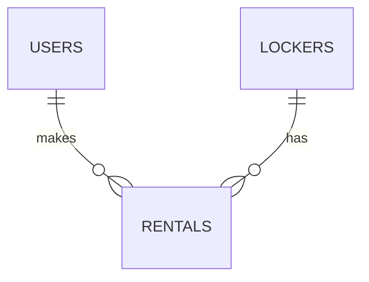

# Database plan

Database: PostgreSQL.

Initial schema: [schema.sql](../backend/database/schema.sql).

## 1. Users

One row per account.

| Field           | Type                     | Purpose                                      |
|-----------------|--------------------------|----------------------------------------------|
| `id`            | Integer, primary key     | Unique user ID                               |
| `email`         | Text, unique             | Sign-in email, stored in lowercase           |
| `password_hash` | Text                     | Hashed password, never the original password |
| `created_at`    | Timestamp with time zone | Account creation time                        |

## 2. Lockers

| Field                 | Type                               | Purpose                                            |
|-----------------------|------------------------------------|----------------------------------------------------|
| `id`                  | Integer, primary key               | Internal locker ID                                 |
| `number`              | Integer, unique                    | Display number: 4                                  |
| `size`                | Text                               | `small` or `large`                                 |
| `price_per_day_cents` | Integer                            | Daily price: 100 means EUR 1.00                    |
| `is_enabled`          | Boolean                            | Whether the locker can be offered for rental       |
| `door_state`          | Text                               | `open`, `closed` or `unknown`; initially `unknown` |
| `last_seen_at`        | Timestamp with time zone, nullable | Last device update; empty until connected          |

## 3. Rentals

| Field               | Type                     | Purpose                                                    |
|---------------------|--------------------------|------------------------------------------------------------|
| `id`                | Integer, primary key     | Unique rental ID                                           |
| `user_id`           | Integer, foreign key     | References `users.id`                                      |
| `locker_id`         | Integer, foreign key     | References `lockers.id`                                    |
| `status`            | Text                     | `pending`, `active`, `overdue`, `completed` or `cancelled` |
| `reserved_until`    | Timestamp with time zone | Checkout reservation deadline                              |
| `starts_at`         | Timestamp with time zone | Agreed rental start                                        |
| `paid_until`        | Timestamp with time zone | Agreed rental end                                          |
| `total_price_cents` | Integer                  | Agreed total, kept even if the locker price changes        |
| `created_at`        | Timestamp with time zone | Rental record creation time                                |



A user can have many rentals over time. A locker can also have many past rentals,
but only one unfinished rental at a time.

Additional rental fields:

| Field                       | Purpose                                                  |
|-----------------------------|----------------------------------------------------------|
| `prepaid_days`              | 1-4 calendar days; default 1                             |
| `completed_at`              | Actual collection/completion time; empty until completed |
| `overdue_daily_fee_cents`   | Agreed overdue fee: 100 cents                            |
| `overdue_terms_version`     | Version of the terms the user accepted                   |
| `overdue_terms_accepted_at` | Server-recorded time of explicit consent                 |

## Rental and overdue rules

- Each rental day ends at **18:00 in `Europe/Dublin`**, including clock changes.
- Before 18:00, the arrival date counts as day one; at or after 18:00, day one is the next date.
- Rent for 1 to 4 days. `paid_until` is the exclusive 18:00 deadline on the final paid day.
- The first overdue EUR 1 becomes due at `paid_until`, then another EUR 1 at each following local 18:00
  until collection and completion are confirmed. `charge_date` is the local date of that 18:00 boundary.
- `overdue_charges` stores the rental, local charge date, amount, currency, payment status,
  Stripe payment reference and payment time. One row per rental/date prevents duplicate daily charges.
- Failed payment does not free the locker or count as a successful charge. Retry the same charge record.
- Require a separate unchecked consent box before checkout. Save its terms version and acceptance time on the server.
- If the user disagrees or needs help collecting belongings, direct them to the operator.
  Operator contact details still need to be supplied; contacting them alone does not waive a fee.
- Consent records and payment status must be verified by the backend, not trusted from browser values.
- Automatic overdue collection, payment-method setup and a daily billing task are future work.
  Reservations save consent; verified Stripe payments now activate rentals.

## Rules for the SQL schema

- Generate IDs and creation timestamps automatically. `last_seen_at`, `completed_at` and unpaid charge payment details
  can be empty.
- Restrict status, size and door state to the values above; prices cannot be negative.
- Require `paid_until > starts_at`. Store times consistently in UTC and display local time in the app.
- Prevent multiple `pending`, `active` or `overdue` rentals for the same locker with a database constraint.
- Reconcile payment before releasing an expired checkout reservation. Rental expiry alone does not release the locker.
- Keep rental history: do not automatically delete rentals when deleting a user or locker.

## Payments

`payments` stores one checkout request per rental: a retry key, fixed request parameters,
the Stripe session ID, status, PaymentIntent ID and confirmation time. It contains no card details. A saved checkout
attempt prevents the rental from being released until its payment is reconciled.

`payment_events` records processed Stripe event IDs to prevent duplicate handling.

## Later tables

| Table             | What it will store                                                      |
|-------------------|-------------------------------------------------------------------------|
| `device_commands` | Unique command ID, rental ID, action, expiry and acknowledgement status |
| `device_events`   | Locker ID, event type, observation time and reported state              |

## Data migrations

After creating the tables, apply `001_add_lockers.sql` from the project folder:

```sh
docker compose exec -T db psql -U paybox -d paybox -v ON_ERROR_STOP=1 < backend/database/migrations/001_add_lockers.sql
```

This adds nine lockers with only Locker 4 enabled. Repeat runs leave existing records unchanged.
Migrations are run manually; restarting Docker does not apply them.
