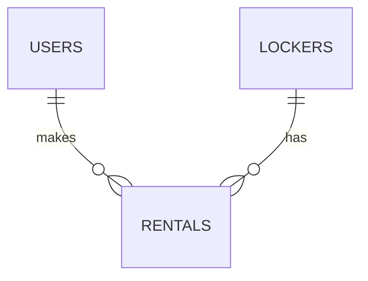

# Database plan

Proposed database: PostgreSQL.

## 1. Users

One row per account.

| Field           | Type                     | Purpose                                      |
|-----------------|--------------------------|----------------------------------------------|
| `id`            | Integer, primary key     | Unique user ID                               |
| `email`         | Text, unique             | Sign-in email, stored in lowercase           |
| `password_hash` | Text                     | Hashed password, never the original password |
| `created_at`    | Timestamp with time zone | Account creation time                        |

## 2. Lockers

| Field                 | Type                               | Purpose                                            |
|-----------------------|------------------------------------|----------------------------------------------------|
| `id`                  | Integer, primary key               | Internal locker ID                                 |
| `number`              | Integer, unique                    | Display number: 4                                  |
| `size`                | Text                               | `small` or `large`                                 |
| `price_per_day_cents` | Integer                            | Daily price: 100 means EUR 1.00                    |
| `is_enabled`          | Boolean                            | Whether the locker can be offered for rental       |
| `door_state`          | Text                               | `open`, `closed` or `unknown`; initially `unknown` |
| `last_seen_at`        | Timestamp with time zone, nullable | Last device update; empty until connected          |

## 3. Rentals

| Field               | Type                     | Purpose                                                    |
|---------------------|--------------------------|------------------------------------------------------------|
| `id`                | Integer, primary key     | Unique rental ID                                           |
| `user_id`           | Integer, foreign key     | References `users.id`                                      |
| `locker_id`         | Integer, foreign key     | References `lockers.id`                                    |
| `status`            | Text                     | `pending`, `active`, `overdue`, `completed` or `cancelled` |
| `reserved_until`    | Timestamp with time zone | Checkout reservation deadline                              |
| `starts_at`         | Timestamp with time zone | Agreed rental start                                        |
| `ends_at`           | Timestamp with time zone | Agreed rental end                                          |
| `total_price_cents` | Integer                  | Agreed total, kept even if the locker price changes        |
| `created_at`        | Timestamp with time zone | Rental record creation time                                |

A user can have many rentals over time. A locker can also have many past rentals,
but only one unfinished rental at a time.

## Rules for the SQL schema

- Require all fields except `last_seen_at`; generate IDs and creation timestamps automatically.
- Restrict status, size and door state to the values above; prices cannot be negative.
- Require `ends_at > starts_at`. Store times consistently in UTC and display local time in the app.
- Prevent multiple `pending`, `active` or `overdue` rentals for the same locker with a database constraint.
- Reconcile payment before releasing an expired checkout reservation. Rental expiry alone does not release the locker.
- Keep rental history: do not automatically delete rentals when deleting a user or locker.

## Later tables

| Table             | What it will store                                                                |
|-------------------|-----------------------------------------------------------------------------------|
| `payments`        | Rental ID, Stripe reference, amount, currency and payment status; no card details |
| `payment_events`  | Unique Stripe event ID and processing status to handle repeated webhooks          |
| `device_commands` | Unique command ID, rental ID, action, expiry and acknowledgement status           |
| `device_events`   | Locker ID, event type, observation time and reported state                        |

